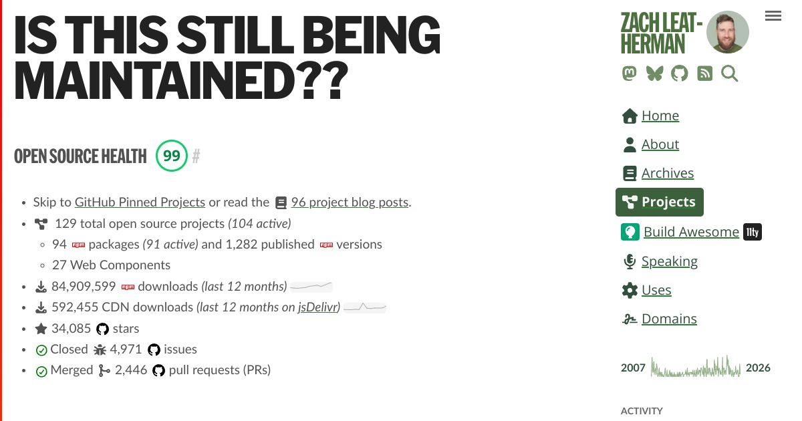

I have _a lot_ of open source projects (of varying sizes and shapes).

At time of writing, I’m currently maintaining ×78 npm packages. Of those, 22 are super lightweight zero-dependency custom elements a.k.a. 🚾 Web Components (_love the future compatibility I get with very little maintenance required_). In addition, I also have a few [active websites](https://www.zachleat.com/domains/) and starter/template projects that are open source too.

I usually rotate maintenance on these and needed a way to quickly scan my little ecosystem of packages to know which ones needed love. Thus, a new little dashboard has appeared on my web site that I’m calling:

[_Is this still being maintained??_](https://www.zachleat.com/projects/)

The name pays homage to those <s>helpful</s> passive aggressive comments folks sometimes leave on issue trackers (mirroring a fair question that perhaps I should be asking myself).

Each project is given a Neglect score that represents how much love it needs. It factors popularity (via npm downloads and GitHub stars) and need (GitHub issues and pull requests, npm audits), and recency (npm publish and GitHub commit dates). It shows how many production dependencies (including transitive ones) that a project uses. It even has a little sparkline to give a little data visualization to how frequently packages are published.

## A broader look

The aggregate statistics there were genuinely surprising to me. _67 million downloads in the last year_ (though this is heavily influenced by dependencies I maintain in Build Awesome/11ty, which are counted separately).

Over 1.1k published versions, 4.7k closed issues, and 2.2k pull requests merged! _(not all by me, of course)_

Currently my most neglected package is the [Eleventy Vue plugin](https://github.com/11ty/eleventy-plugin-vue) (which owns 31 of my 42 total npm audits) and I’m actively deciding whether to revive it or retire it 🫣.

**All of my 77 other packages only have 11 total npm audit reports!** I’m feeling extremely proud of that, which feels related to the work I’ve been doing to [lock down publishing workflows](https://www.zachleat.com/web/npm-security/) and [reduce dependencies](https://www.11ty.dev/blog/dependency-watch/). Though that number may change over time, I now have an easy centralized place to check it. This report also makes it very obvious the relationship between dependency count and audit reports. [Keep reducing those dependencies, y’all!](https://e18e.dev/)

The other result of monitoring this report is that I have archived a bunch of old projects that I don’t want to track, which has a nice cleansing feeling to it.
