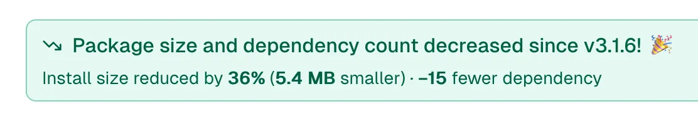

Well, [@npmx.dev](https://bsky.app/profile/did:plc:u5zp7npt5kpueado77kuihyz) seems to be happy with our v4 canaries so far!

[npmx.dev/package/@11t...](https://npmx.dev/package/@11ty/eleventy/v/4.0.0-alpha.8)

