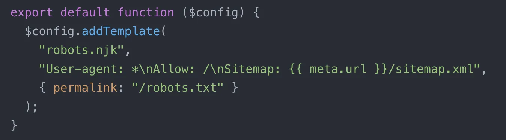

Did you know? Your robots.txt, 404 page, or sitemap.xml don't need to be files in your project. Virtual templates let you generate any output file via config (or plugin).

Read more: [https://www.11ty.dev/docs/virtual-templates/](https://www.11ty.dev/docs/virtual-templates/)

