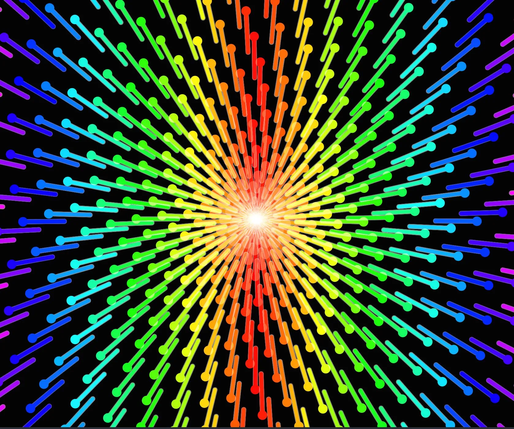

are… are these \<input type=range>

> how i wish i had stopped there, before diving so deeply in the awful catacombs of Using CSS Too Much. before facing those great manmade horrors
> 
> 
> 
> — [henry ✷](https://bsky.app/profile/strange.website) ([February 10, 2025 at 6:36:45 PM UTC](https://bsky.app/profile/strange.website/post/3lhtrysrvw223))
