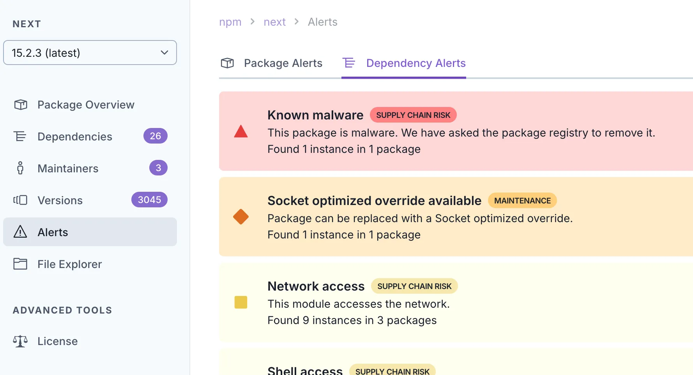

Why does [socket.dev](https://socket.dev) report that the latest version of next.js has a malware dependency? [socket.dev/npm/package/...](https://socket.dev/npm/package/next/alerts/15.2.3?tab=dependencies)

“Malicious code in gen-mapping (npm) Any computer that has this package installed or running should be considered fully compromised.”

