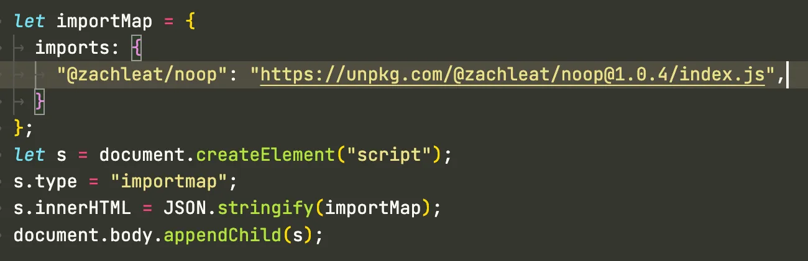

TIL Chrome and Safari support dynamic creation of Import Maps in script 👀

Firefox does too but with a few \*hefty\* limitations:

1\. “Import maps are not allowed after a module load or preload has started” (separate non-module \`\<script>\`)  
2\. “Multiple import maps are not allowed.” 😭

