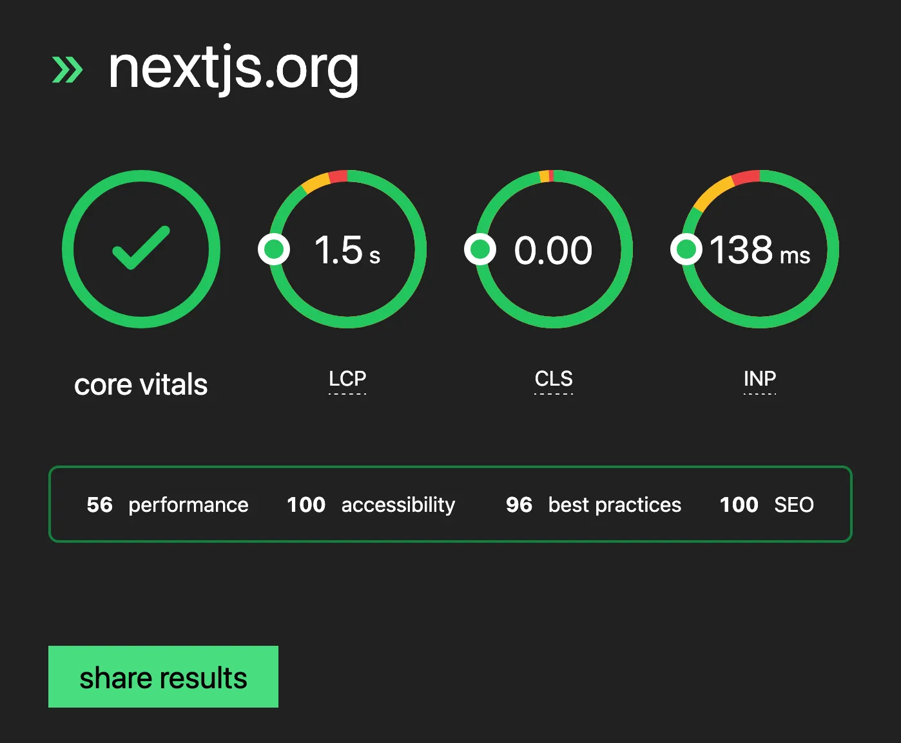

[@danielroe.dev](https://bsky.app/profile/did:plc:jbeaa5kdaladzwq3r7f5xgwe) I’m curious if you would be interested in making the lab data on page-speed.dev more visually prominent?

just as an example I would argue that the 56 perf on [nextjs.org](https://nextjs.org) should have more visual weight here

