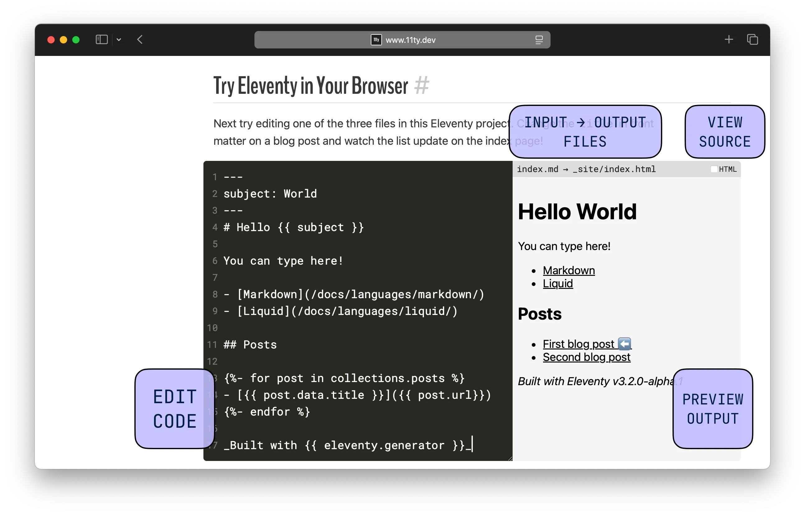

Decoupled this one right out of [@11ty.dev](https://bsky.app/profile/did:plc:i3khfmz4tvrcu7fwrdoqr4u2)’s new demo/playground component: [bsky.app/profile/11ty...](https://bsky.app/profile/11ty.dev/post/3lpcyjkim7m2l)

> Try out the new interactive Playground component on the docs home page: [www.11ty.dev#try-eleventy...](https://www.11ty.dev/#try-eleventy-in-your-browser)
> 
> That’s right: we’re running Eleventy in the build and in the browser. This unlocks many more exciting options for Eleventy projects — stay tuned!
> 
> 
> 
> — [Build Awesome (11ty)](https://bsky.app/profile/11ty.dev) ([May 16, 2025 at 9:39:47 PM UTC](https://bsky.app/profile/11ty.dev/post/3lpcyjkim7m2l))
