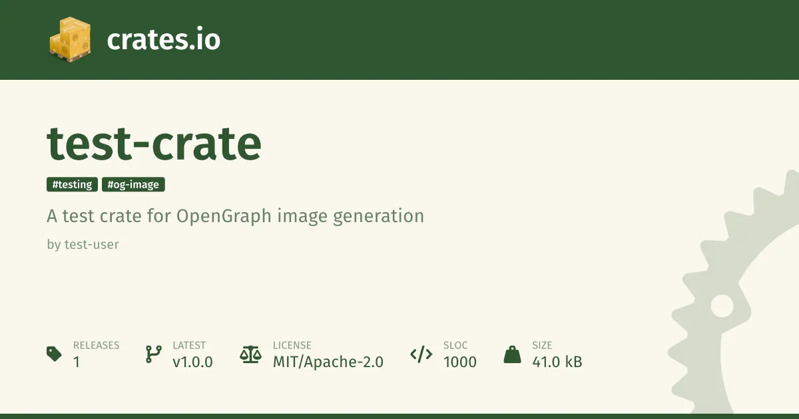

it would be super cool if [@npmjs.bsky.social](https://bsky.app/profile/did:plc:3urdhshc23yyxn42xtfzppkw) added this! [bsky.app/profile/tobi...](https://bsky.app/profile/tobias.bieniek.cloud/post/3lsjealy2hc2u)

> 🦀 [crates.io](https://crates.io) might get OpenGraph images for each crate soon: [github.com/rust-lang/cr...](https://github.com/rust-lang/crates.io/pull/11436) ✨
> 
> [#rustlang](https://bsky.app/hashtag/rustlang)
> 
> 
> 
> — [Tobias Bieniek](https://bsky.app/profile/tobias.bieniek.cloud) ([June 26, 2025 at 2:41:05 PM UTC](https://bsky.app/profile/tobias.bieniek.cloud/post/3lsjealy2hc2u))
