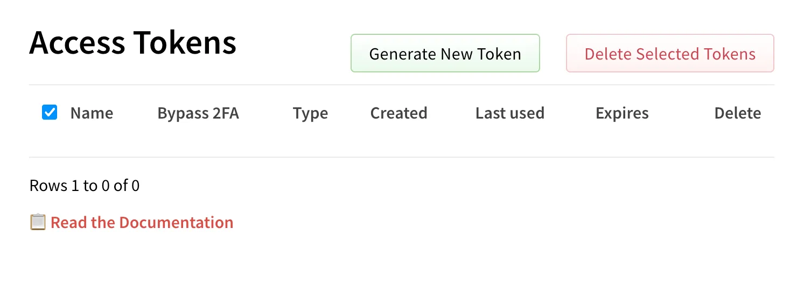

This took a lot of tedious work but I’m now npm token free, weee!

The entire [@11ty.dev](https://bsky.app/profile/did:plc:i3khfmz4tvrcu7fwrdoqr4u2) ecosystem is now using Trusted Publishers ([docs.npmjs.com/trusted-publ...](https://docs.npmjs.com/trusted-publishers))

