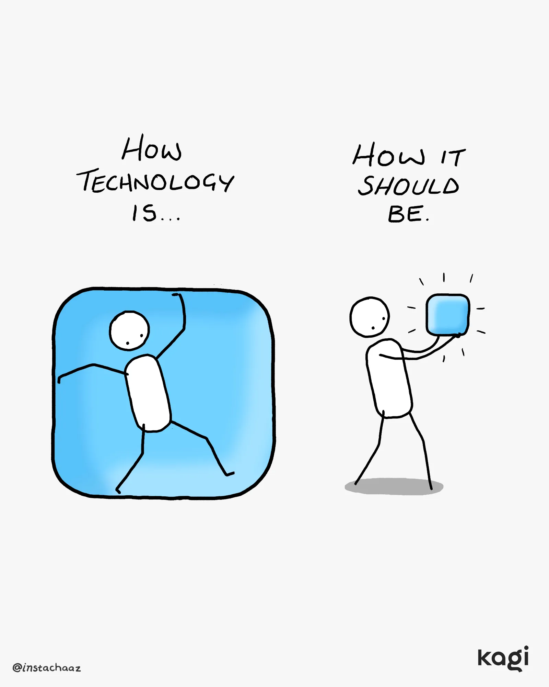

this very aptly applies to developer tools as well

> Technology should serve you, not trap or burden you.
> 
> 
> 
> — [Kagi HQ](https://bsky.app/profile/kagi.com) ([January 30, 2026 at 4:10:08 PM UTC](https://bsky.app/profile/kagi.com/post/3mdnoukizzc2g))
