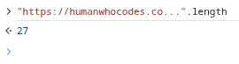

Another follow up here: [@tbroyer.ltgt.net](https://bsky.app/profile/did:plc:wwv7b2hkcaghqlyy4mew2tzs) found the offending truncation code and it is not on [@bsky.app](https://bsky.app/profile/did:plc:z72i7hdynmk6r22z27h6tvur)’s part here. I’m sorry folks — I was far too harsh in my original post!

[bsky.app/profile/tbro...](https://bsky.app/profile/tbroyer.ltgt.net/post/3megw62c2cs2b)

> And here it is: [github.com/humanwhocode...](https://github.com/humanwhocodes/crosspost/blob/main/src/util/bluesky-facets.js#L199)
> 
> All links to [humanwhocodes.com/%E2%80%A6](https://humanwhocodes.com/…) will be turned into [humanwhocodes.co..](https://humanwhocodes.co..).
> 
> 
> 
> — [Thomas Broyer](https://bsky.app/profile/tbroyer.ltgt.net) ([February 9, 2026 at 4:57:16 PM UTC](https://bsky.app/profile/tbroyer.ltgt.net/post/3megw62c2cs2b))
