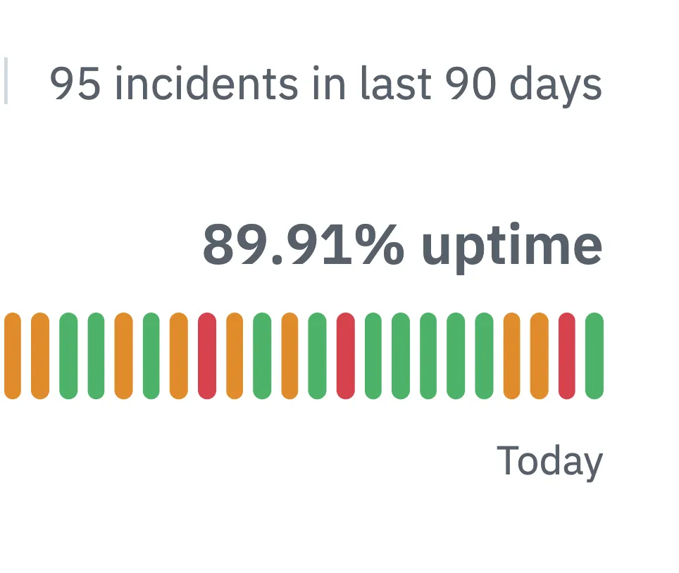

mathematically speaking 89.99999% has six nines

> IT'S HAPPENING
> 
> GITHUB, THE FIRST ENTERPRISE CLOUD SOLUTION TO REACH ZERO NINES RELIABILITY
> 
> [https://mrshu.github.io/github-statuses/](https://mrshu.github.io/github-statuses/)
> 
> [#github](https://bsky.app/hashtag/github)
> 
>  
> 
> — [abadidea](https://bsky.app/profile/0xabad1dea.infosec.exchange.ap.brid.gy) ([April 2, 2026 at 9:07:56 AM UTC](https://bsky.app/profile/0xabad1dea.infosec.exchange.ap.brid.gy/post/3miiu6t52mpo2))
