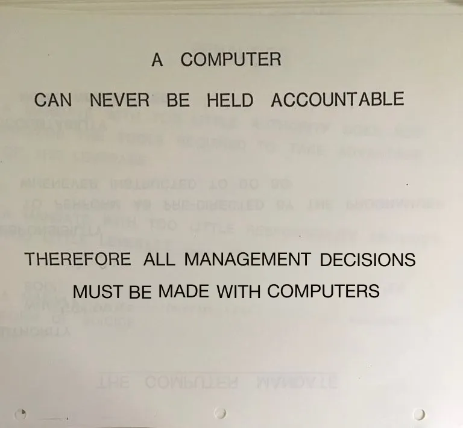

love the design aesthetic of ever-so-slightly-translucent paper — has anyone done this on the web?

> leaked software industry training manual (2026)
> 
> 
> 
> — [natemoore on elm street 👻](https://bsky.app/profile/natemoo.re) ([April 20, 2026 at 2:25:27 PM UTC](https://bsky.app/profile/natemoo.re/post/3mjwocznsjk2t))
