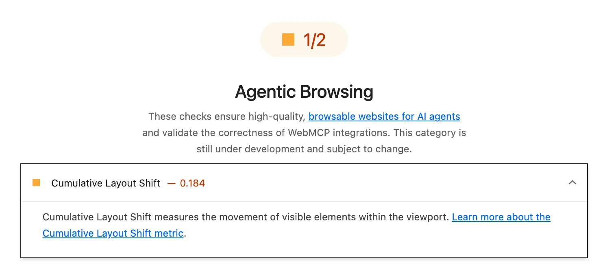

TIL Lighthouse is adding an Agentic Browsing metric:

[developer.chrome.com/docs/lightho...](https://developer.chrome.com/docs/lighthouse/agentic-browsing/scoring)

That CLS is listed as a sub-metric seems like a big ol’ code smell to me (and reveals some brittle implementation?): are agents relying on element dimensions?

