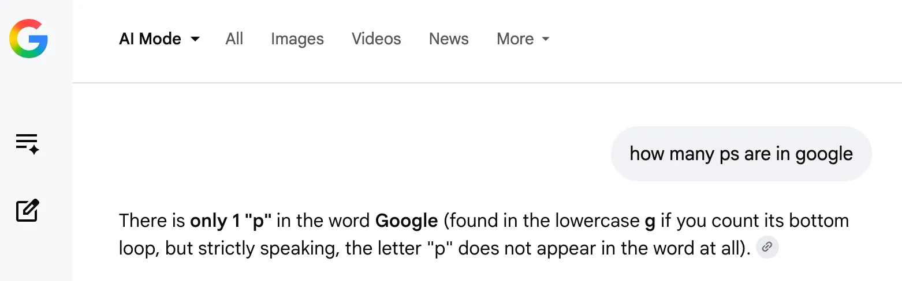

There is one “P” in the word Google, according to this cited [@usatoday.com](https://bsky.app/profile/did:plc:2yyvxfpy4s63ars26dzlpbf2) source with the following quote: “Google isn't ready to tell us what the ‘P’ in Android P will stand for…”

[www.usatoday.com/story/tech/c...](https://www.usatoday.com/story/tech/columnist/baig/2018/05/08/googles-android-p-promises-help-you-control-your-digital-wellbeing/589810002/)

We are doing good work here.

> what in the capital-D descender is going on here
> 
> 
> 
> — [Zach Leatherman](https://bsky.app/profile/zachleat.com) ([May 27, 2026 at 8:45:45 PM UTC](https://bsky.app/profile/zachleat.com/post/3mmuet426m22z))
