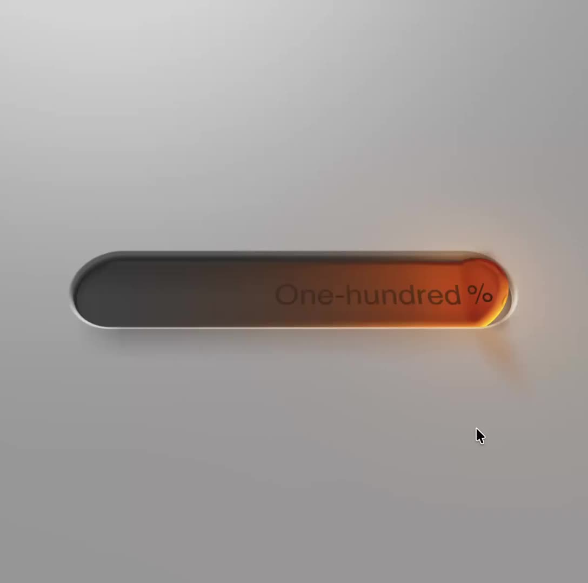

Select the text on this demo 🤯 [html-in-canvas.dev/demos/hello-...](https://html-in-canvas.dev/demos/hello-world/)

> 👉 HTML-in-Canvas is a bridge implementation between HTML/CSS and pixel manipulation (Canvas/WebGL).  
> 👉 Available in Chrome behind the \`canvas-draw-element\` flag.  
> 👉 We discussed the challenges: cross-origin data leakage, video support, user state privacy, performance  
> 👀 Demos: [html-in-canvas.dev/demos/](https://html-in-canvas.dev/demos/)
> 
> 
> 
> — [Marina Aísa](https://bsky.app/profile/marinaaisa.com) ([June 16, 2026 at 3:51:06 PM UTC](https://bsky.app/profile/marinaaisa.com/post/3mog5once2s2r))
