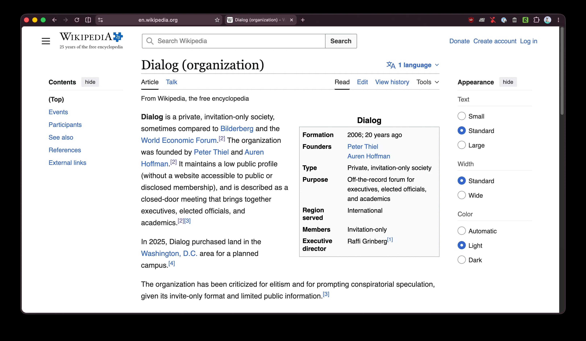
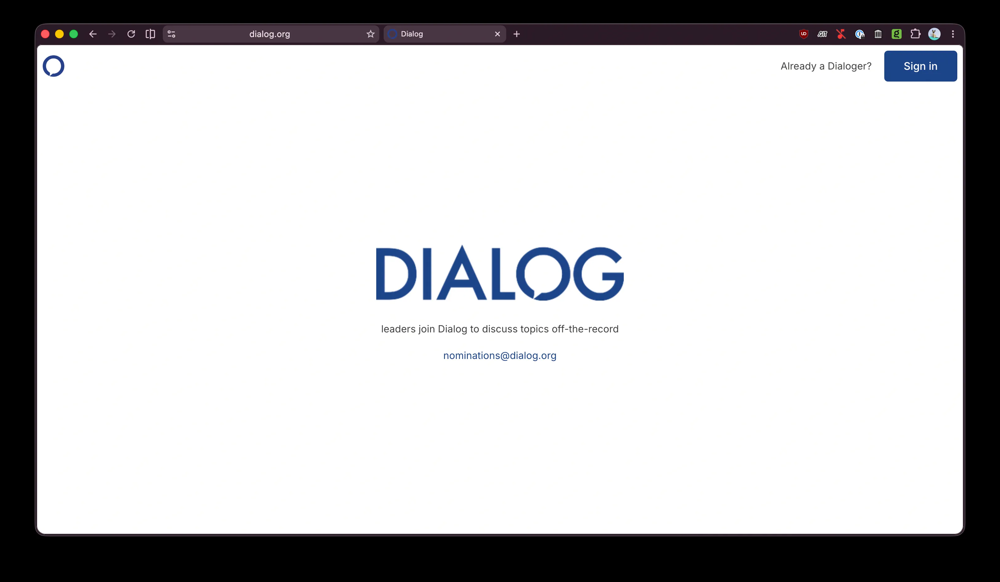
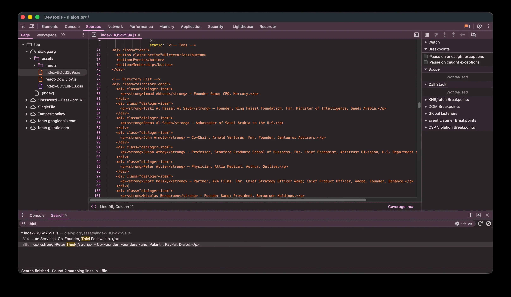

Does anyone know more detail about how this was leaked, technically? Looks like the site was using Next.js and some static HTML was embedded in a static JavaScript bundle — another sourceMap leak?

> SCOOP: So remember Dialog, Peter Thiel's private society that doesn't have a public website and no public list of members?
> 
> I (along with a number of other journalists) have just been tipped off that embedded in the code of their closed off website there IS what seems to be a list of some members.
> 
>   
> 
> — [maia arson crimew 🏴](https://bsky.app/profile/crimew.gay) ([June 16, 2026 at 12:18:05 AM UTC](https://bsky.app/profile/crimew.gay/post/3moejkbqctc2z))
