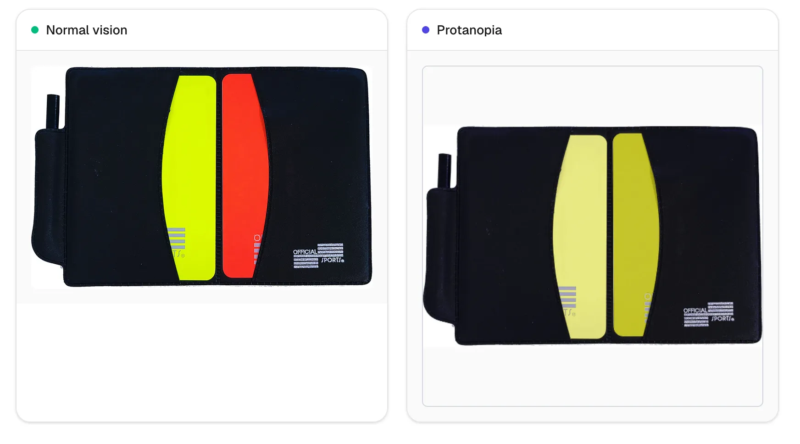

I was curious what the red/yellow cards used in the World Cup would look like with color vision deficiency (Protanopia shown).

Seems like a player could be shown a card and not know the color. Does it matter with sufficient contrast and only 2 cards?

Could be easily solved by adding a symbol.

