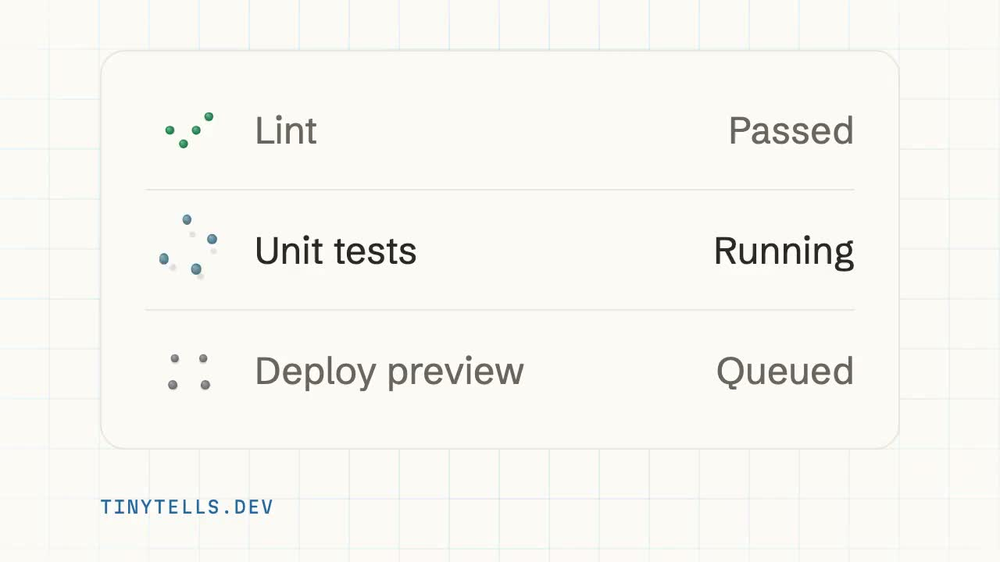

🚨 Web Component Klaxon 🚨

> My first open source release: Tiny Tells!
> 
> Six small status characters in one \<tiny-tell> tag.
> 
> They're animated like little cartoon characters, so a state change is a reaction, not an icon swap or a spinner.
> 
> MIT licensed, 14 KB, no dependencies. [tinytells.dev](https://tinytells.dev)
> 
> 
> 
> — [Brian Talbot](https://bsky.app/profile/talbs.me) ([October 19, 2026 at 1:13:13 PM UTC](https://bsky.app/profile/talbs.me/post/3mya75g72rc2x))
