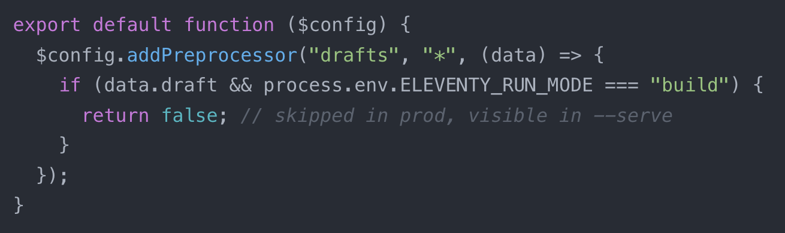

Add support for Drafts (in-progress content) using this five line config. This includes draft content during --serve or --watch but not with a regular build!

Learn more: [https://www.11ty.dev/docs/config-preprocessors/](https://www.11ty.dev/docs/config-preprocessors/)

