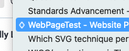

Without exaggeration, my number one complaint (for years!) with Firefox as my daily driver was that there was no icon to show minimized windows in the Window menu on Mac. I often accidentally hide windows with ⌘+M and it was annoying to find those to reopen 😅

So whoever added the ♢: you’re incredible and I love you—thank you.

