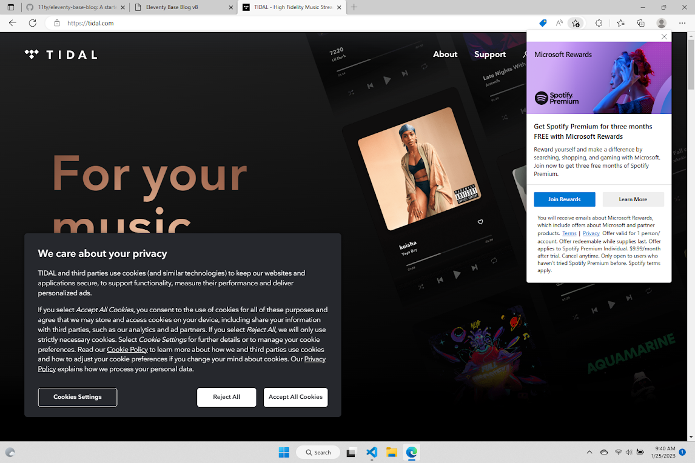

Getting comfortable with this new Windows laptop—navigated over to play some music on [https://tidal.com/](https://tidal.com/) in the Edge browser and it showed me what appears to be an OS-level advertisement (?) for Spotify.

Microsoft… I, uh… what are y’all doing?

