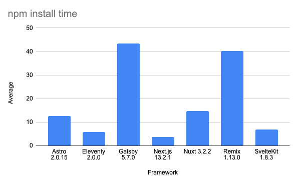

\`npm install\` time (in seconds)

(forcing a clean cache, average of 5 runs)

Notably, next.js seems to bypass \`npm\` by vendoring its dependencies (speedier install, without those pesky npm audits)

