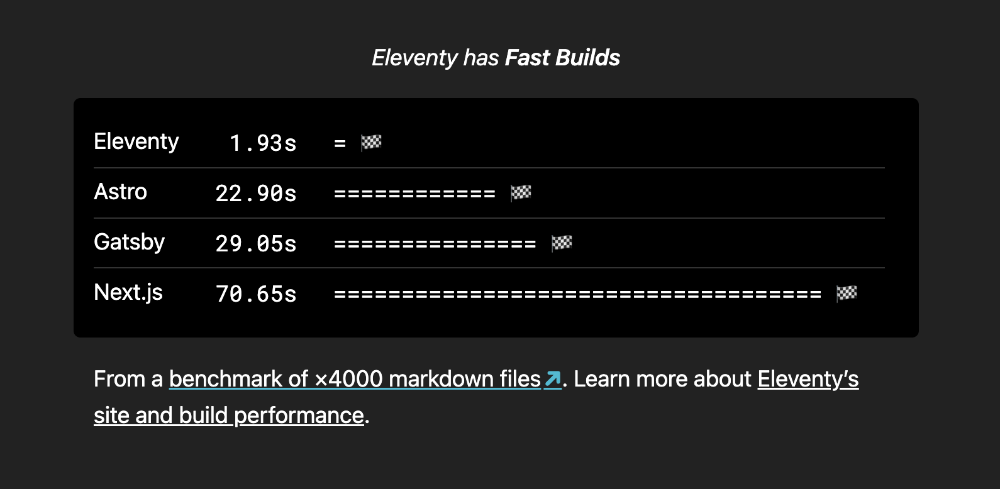

Experimenting with an \`esbuild\` style animated ASCII benchmark chart on the [@eleventy](https://fosstodon.org/@eleventy) home page 👀

(inspired by [https://esbuild.github.io/](https://esbuild.github.io/))

