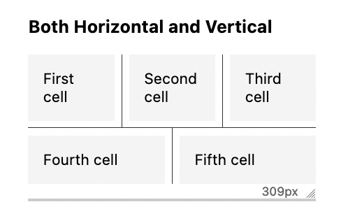

A casual reminder that open sourcing things (even small things) is awesome, \`flex-luthor\` v4 now has connected separators thanks to [@chriskirknielsen](https://mastodon.social/@chriskirknielsen)!

[https://github.com/zachleat/flex-luthor](https://github.com/zachleat/flex-luthor)

