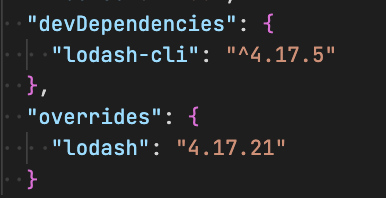

[https://docs.npmjs.com/cli/v8/configuring-npm/package-json#overrides](https://docs.npmjs.com/cli/v8/configuring-npm/package-json#overrides) to override a outdated shrinkwrapped dependency was clutch today.

Trying to use \`lodash-cli\` with the latest version of \`lodash\` and this \`package.json\` addition did the trick:

