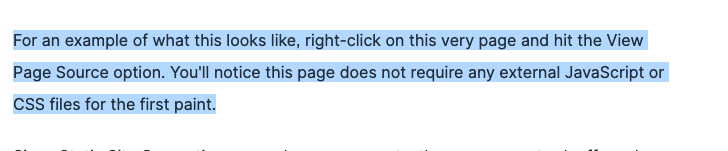

[@mhartington](https://mastodon.social/@mhartington) hey Mike I was just reviewing some Stencil docs for a web components talk and stumbled across this reference, which might need an update!

[https://stenciljs.com/docs/static-site\-generation](https://stenciljs.com/docs/static-site-generation)

Related: [https://github.com/ionic-team/stencil-site/pull/902](https://github.com/ionic-team/stencil-site/pull/902)

