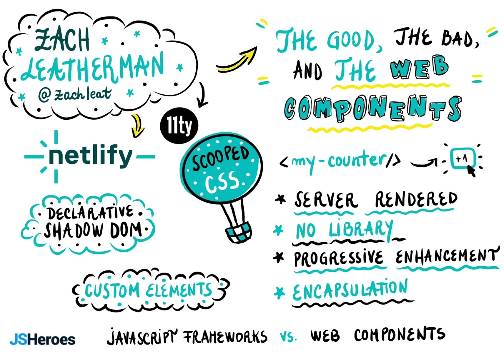

Having an incredible time at [#JSHeroes](https://fediverse.zachleat.com/tags/JSHeroes) today!

Originals:  
[https://twitter.com/jsheroes/status/1659117804929392641](https://twitter.com/jsheroes/status/1659117804929392641)  
[https://twitter.com/jsheroes/status/1659146035074138113](https://twitter.com/jsheroes/status/1659146035074138113)

 
