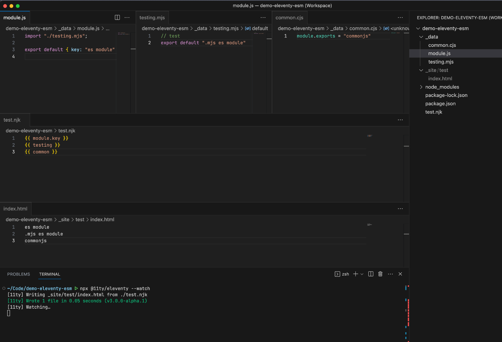

Project [@eleventy](https://fosstodon.org/@eleventy) Big Deal ESM update:

✅ Added support for resolving ESM dependencies for --watch/--serve.  
✅ Added support for .mjs extension to Data Files

Progress!

[#11ty](https://fediverse.zachleat.com/tags/11ty) [#11tyESM](https://fediverse.zachleat.com/tags/11tyESM)

