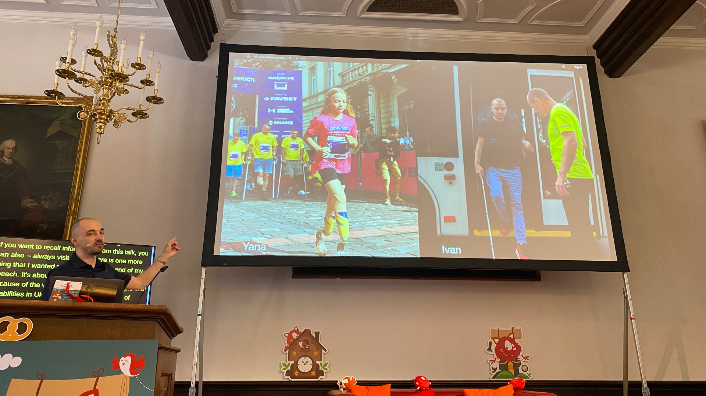

At [@smashingconf](https://mastodon.social/@smashingconf) this week, Slava Shestopalov reminded us that the Russian invasion of Ukraine is creating more people that need accessible experiences—so investing in accessibility testing and improving those experiences in our work is one small way that we can do our part.

