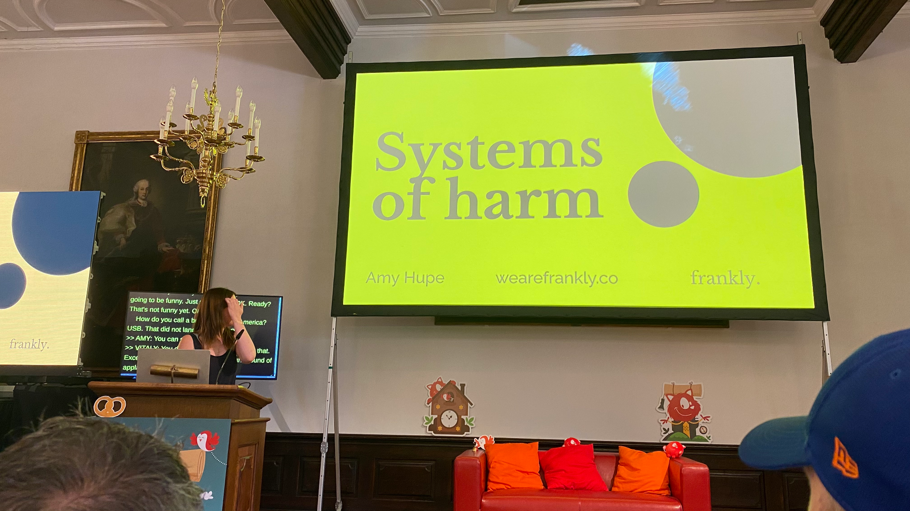

“You can create really inaccessible experiences from accessible components.”

—[@Amy\_Hupe](https://social.design.systems/@Amy_Hupe) in their talk Systems of Harm at [@smashingconf](https://mastodon.social/@smashingconf) Freiburg

