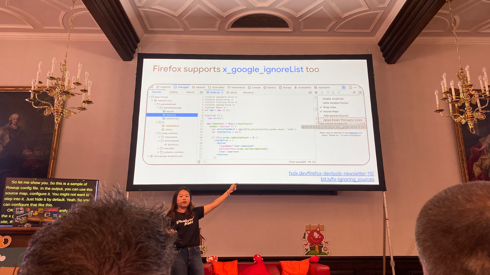

Absolutely loved that [@jecfish](https://indieweb.social/@jecfish) gave a shout out to Firefox Developer Tools in their energetic talk on Source Maps at [@smashingconf](https://mastodon.social/@smashingconf) Freiburg:

