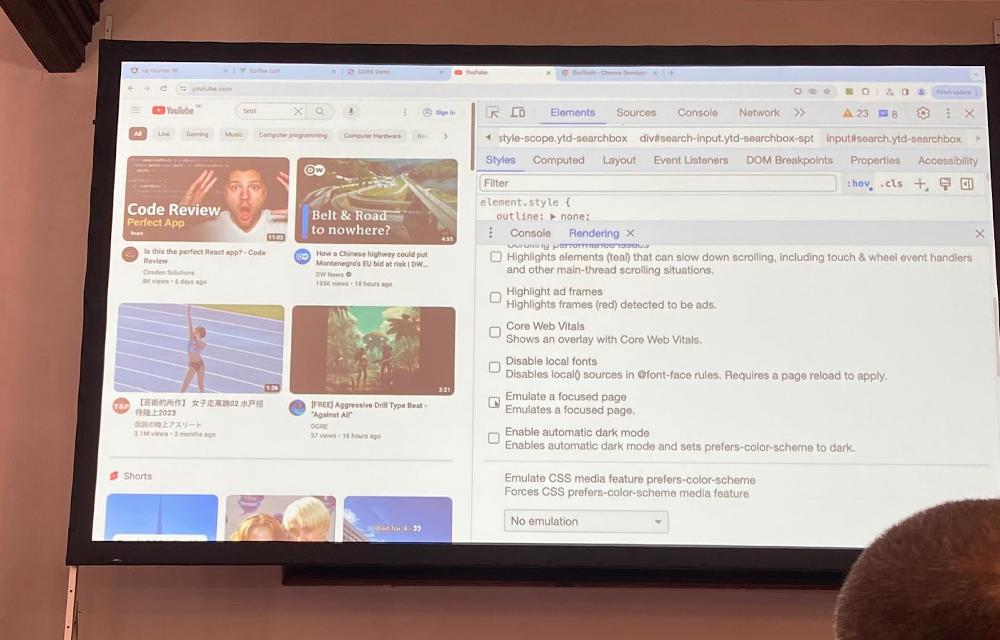

Have you ever struggled with a focusable element (custom drop down menu) that disappears when you swap focus to your Developer Tools?

This “Emulate a focused page” checkbox is for you!

More: [https://developer.chrome.com/docs/devtools/rendering/apply-effects/#emulate-a-focused-page](https://developer.chrome.com/docs/devtools/rendering/apply-effects/#emulate-a-focused-page)

