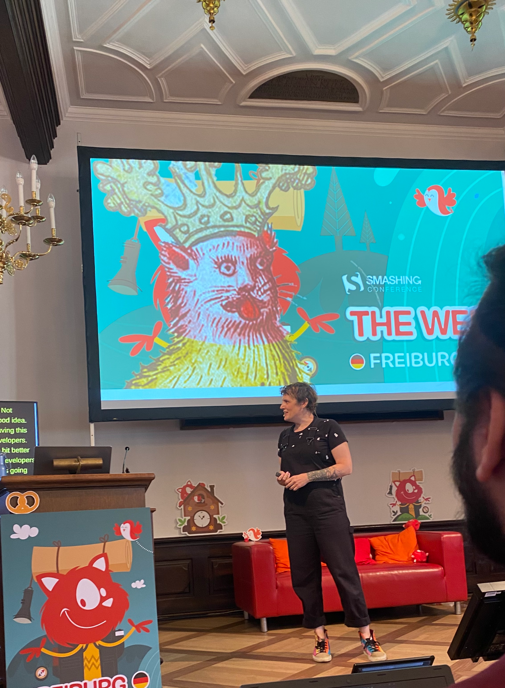

And of course the always entertaining [@mia](https://front-end.social/@mia) made a couple of very important points at [@smashingconf](https://mastodon.social/@smashingconf) Freiburg:

1\. Gave much needed historical attribution to [@jensimmons](https://front-end.social/@jensimmons) for their work on Intrinsic Web Design.  
2\. Reminded us that media queries aren’t going away even if container queries are ubiquitous. They’ll continue to be useful for non-size related things like \`prefers-reduced-motion\` and \`hover\`, etc.  
3\. Style queries are coming and they are awesome when used with Custom Properties.

