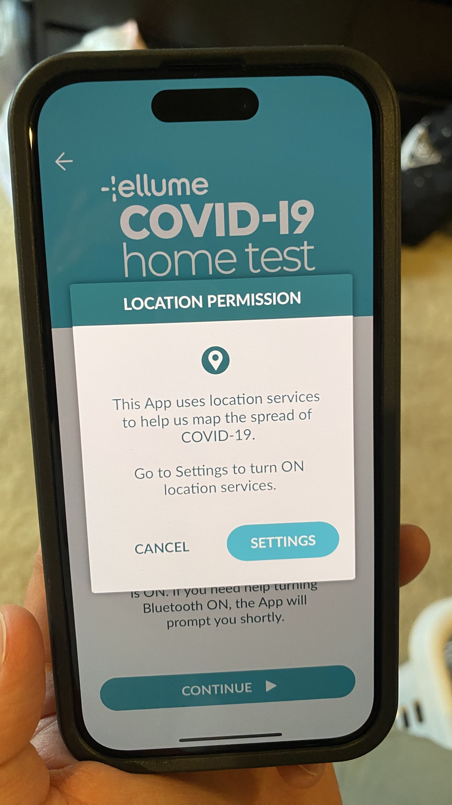
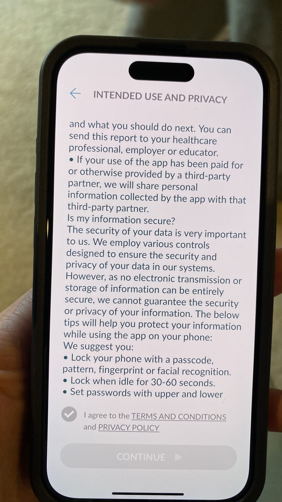

Since folks are asking:

The only way to administer the test and view results is via the smartphone app. The app requires Bluetooth permissions and asks for location, first/last name, date of birth, email, gender, and address. Test results are automatically reported back to the local/state/federal government.

I’ve attached screenshot receipts.

   
