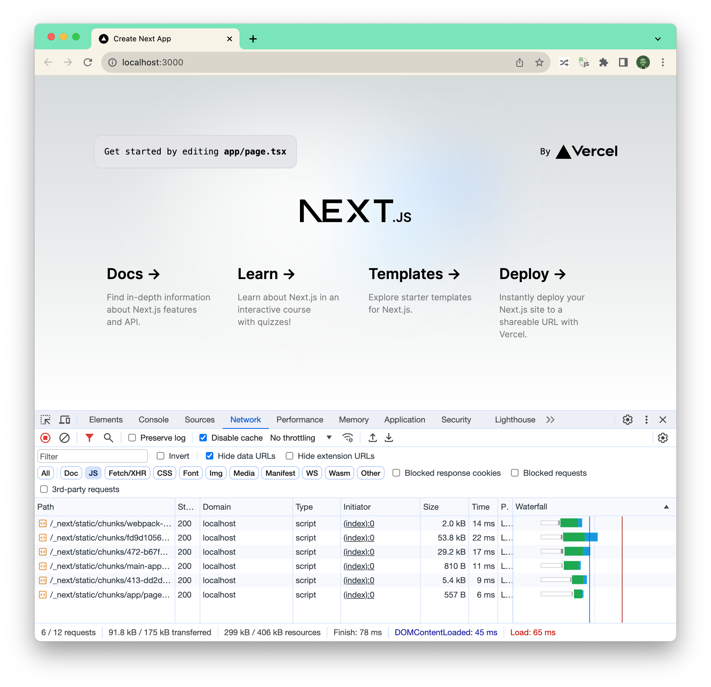

Vercel’s Next.js v14 has shipped and (as one does) I had a look at the JavaScript footprint of the production build of Hello World:

v14 (2023): 299 kB  
v13 (2022): 272 kB  
v12 (2021): 228 kB

Unfortunately the same trend continues, even with a new bundler: the bundles are growing!

(and with Tailwind included by default, too)

