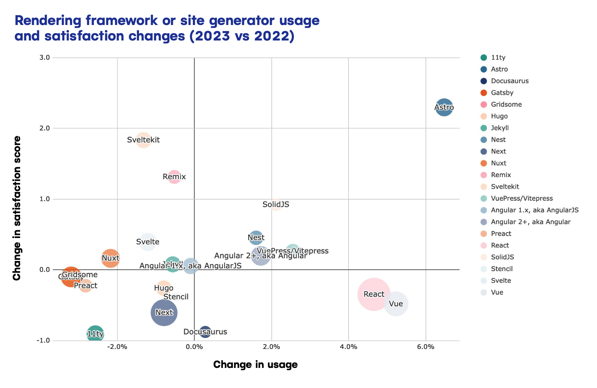

Alright, this graph from Netlify’s “State of the Web” survey is… intellectually dishonest. And I have to weigh in on it now because a few folks have been making some \*specious\* assumptions and tagging me 😬

I get it: Netlify wants to highlight graphs that make Next.js look bad but c’mon—leave me out of it.

(I also understand that their resident statistics person departed the company so… it’s unlikely that this was malicious)

🧵🔽

