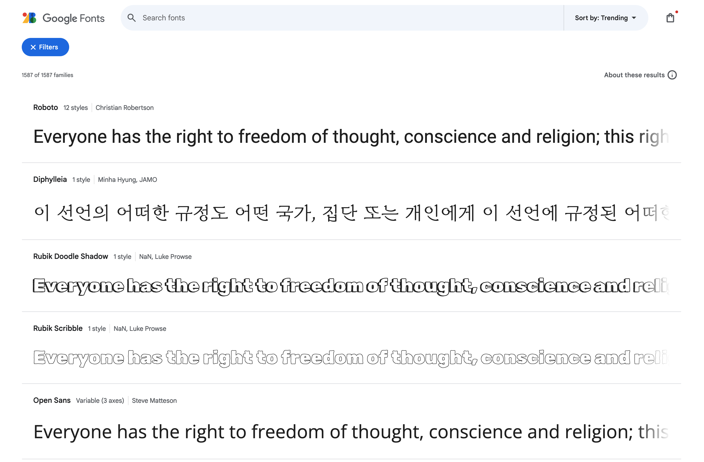

Looks like Google Fonts placeholder text is pulling excerpts from the UN’s Universal Declaration of Human Rights 👀

[https://fonts.google.com/](https://fonts.google.com/)

[https://www.un.org/en/about-us/universal-declaration-of-human-rights](https://www.un.org/en/about-us/universal-declaration-of-human-rights)

