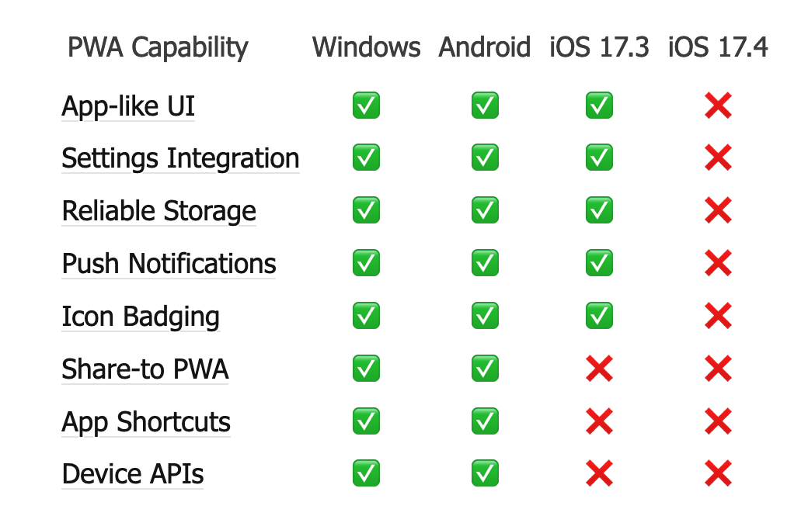

The table shows how much of the web is being broken with the release of iOS 17.4.

via [https://infrequently.org/2024/02/home-screen-advantage/](https://infrequently.org/2024/02/home-screen-advantage/)

