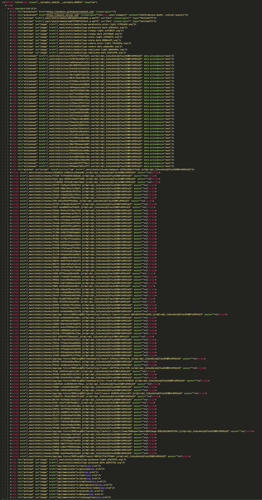

Here’s the source code between the doctype and the \<title> for this site:

×26 \<link rel="preload">  
×36 external \<link rel="stylesheet">  
×91 external \<script src>

This is not a nuanced point I’m making. We’re not debating the finer points of complicated web performance trade-offs. This is a very slow web site.

