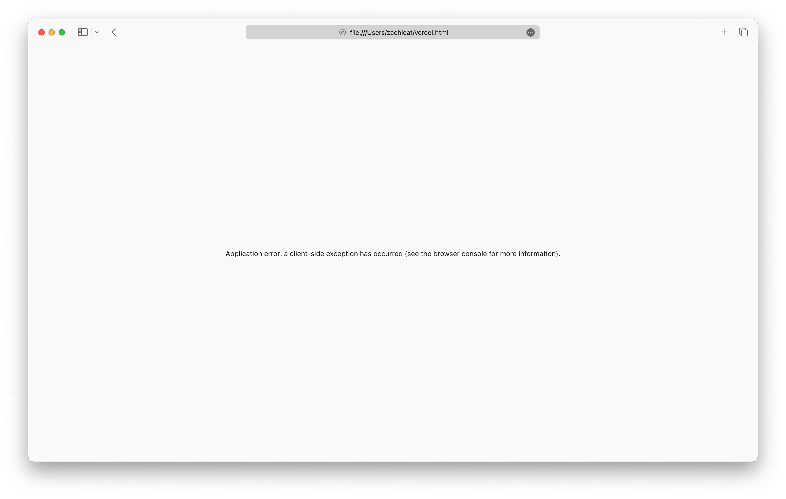
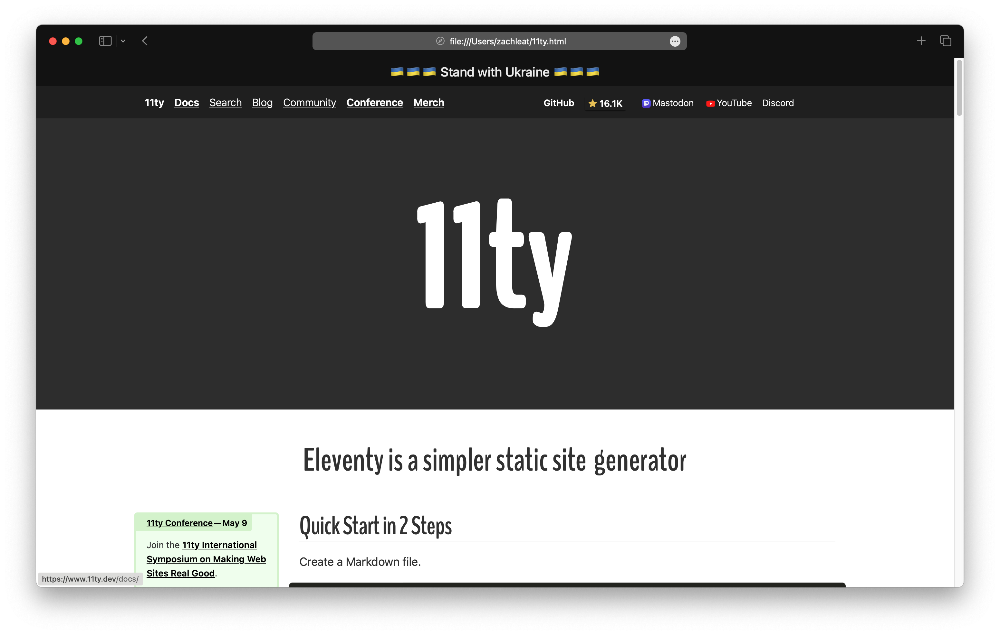

Finally we have a CLI to definitively answer whether something is a web site or a web app: [https://github.com/Y2Z/monolith](https://github.com/Y2Z/monolith)

See if you can tell which is which (bonus points if you can guess which HTML file is 9.6MB and which is 703KB)

 
