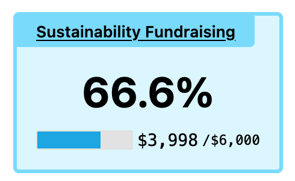
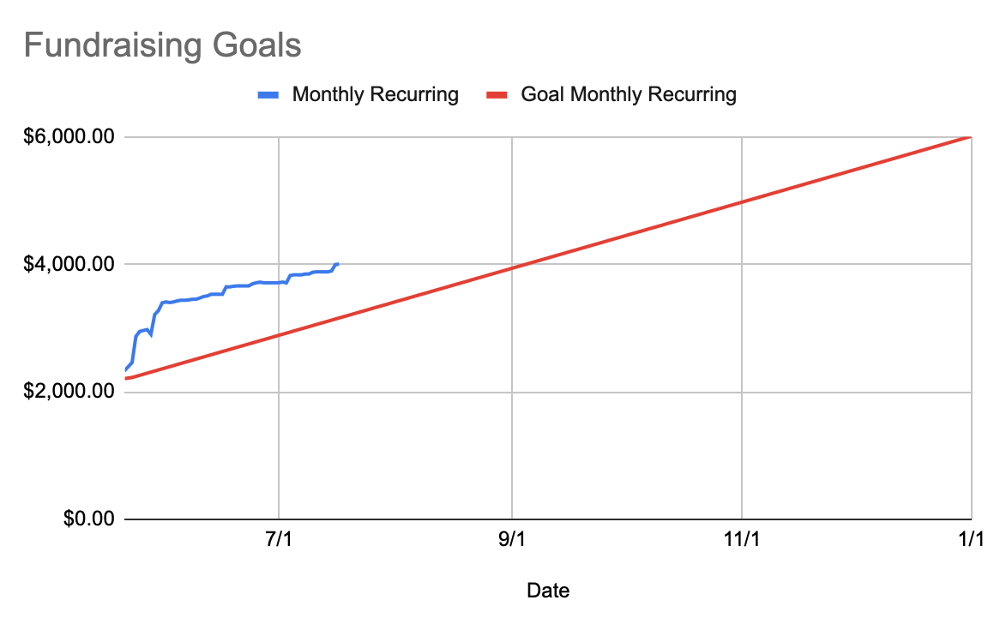

Very important news: [@eleventy](https://fosstodon.org/@eleventy)’s sustainability fundraising goal currently at 66.6%

[https://www.11ty.dev/blog/sustainability-fundraising/](https://www.11ty.dev/blog/sustainability-fundraising/)

Thank you everyone! We still need your help but we’re on track to make 11ty sustainable in 2024!

 
