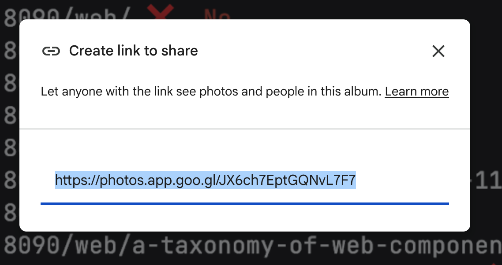

Wow, just learned that Google Photos is actively generating \`goo.gl\` share URLs.

Edit: it’s possible this URL will be unaffected, as the original blog post notes the retirement of \`https​://goo.gl\` links. However, I do have Google Photos shared albums currently using \`https​://goo.gl\` links, so 😬🤷

