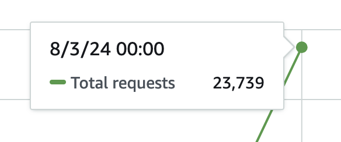

look—did I yolo this to production in the same day that I learned how to do it? yes, yes I did

vercel rewrite -> cloudfront -> api gateway -> aws lambda function is running the 11ty screenshots API now 👀

