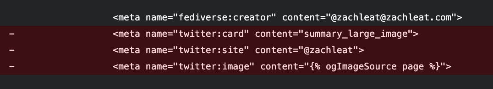

Found some unnecessary twitter metadata still sitting around on my web site and it’s always a good time to delete code (\*especially\* now).

Might be worth checking your web sites to see if you can delete it too?

