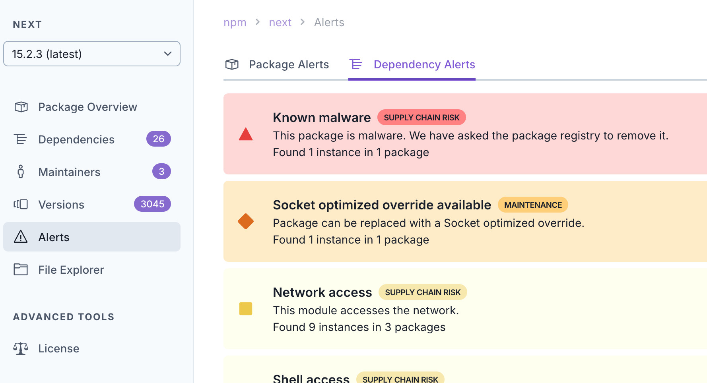

Why does socket.dev report that the latest version of next.js has a malware dependency? [https://socket.dev/npm/package/next/alerts/15.2.3?tab=dependencies](https://socket.dev/npm/package/next/alerts/15.2.3?tab=dependencies)

“Malicious code in gen-mapping (npm) Any computer that has this package installed or running should be considered fully compromised.”

Update: looks like this is a pretty big flaw in the vulnerability scanner — not in next (check the replies for more info)

