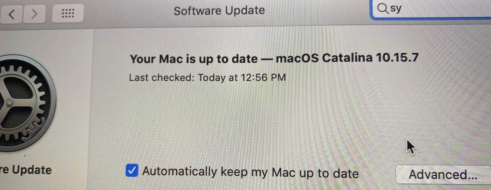
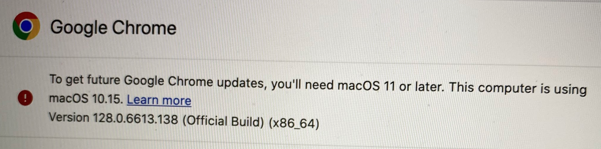

Saw some wild messaging from Apple in the Software Update app on an old MacBook — in fact the system was \*not\* up-to-date. Surfaced via a Google Chrome EOL message.

Got them switched over to the latest version of Firefox just fine 👀

The web should be for everyone (and not just on new hardware)

 
