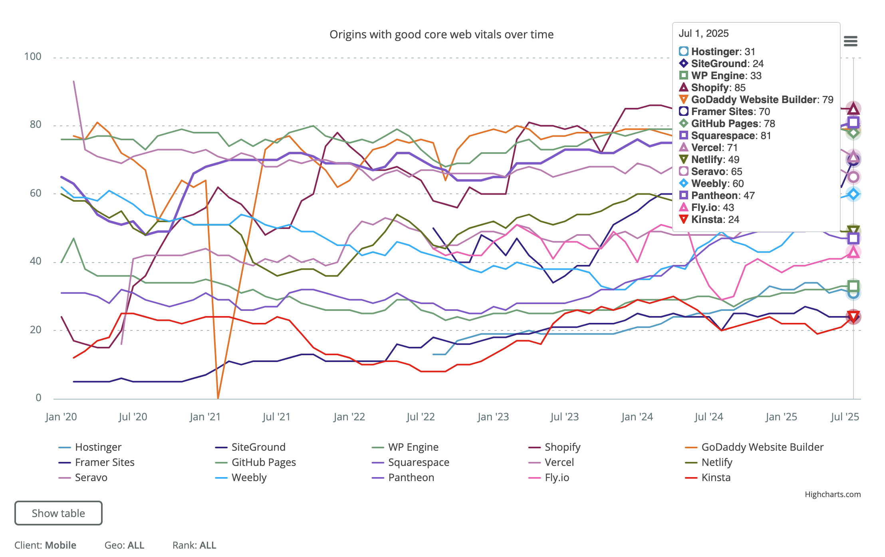

Looks like the above was last updated in November 2024 but links to the HTTP Archive Tech Report for newer data: [https://httparchive.org/reports/techreport/tech?good-cwv-over-time=TTFB&tech=Hostinger,SiteGround,WP+Engine,Shopify,GoDaddy+Website+Builder,Framer+Sites,GitHub+Pages,Squarespace,Vercel,Netlify,Seravo,Weebly,Pantheon,Fly.io,Kinsta&geo=ALL&rank=ALL#comparison-good-cwvs](https://httparchive.org/reports/techreport/tech?good-cwv-over-time=TTFB&tech=Hostinger,SiteGround,WP+Engine,Shopify,GoDaddy+Website+Builder,Framer+Sites,GitHub+Pages,Squarespace,Vercel,Netlify,Seravo,Weebly,Pantheon,Fly.io,Kinsta&geo=ALL&rank=ALL#comparison-good-cwvs)

Here’s a screenshot from 01 July 2025:

