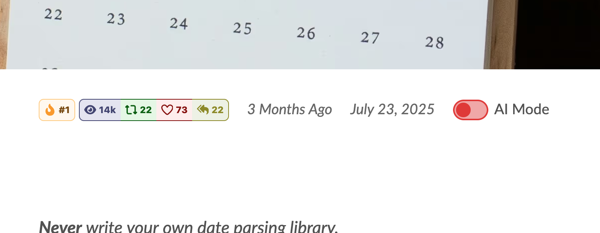

went on a small side quest this morning and added an AI Mode toggle to my blog posts

e.g. [https://www.zachleat.com/web/adventures-in\-date-parsing/](https://www.zachleat.com/web/adventures-in-date-parsing/)

